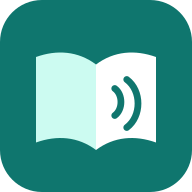
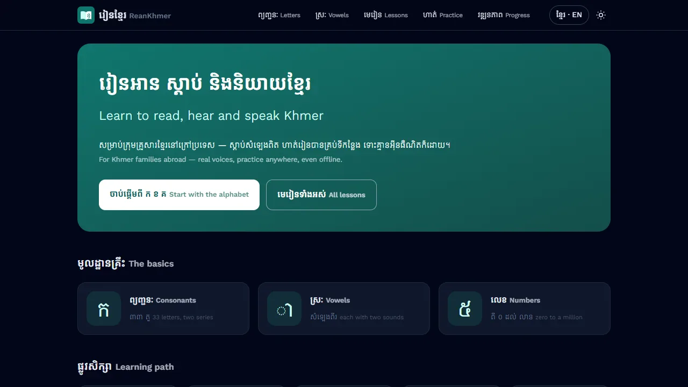
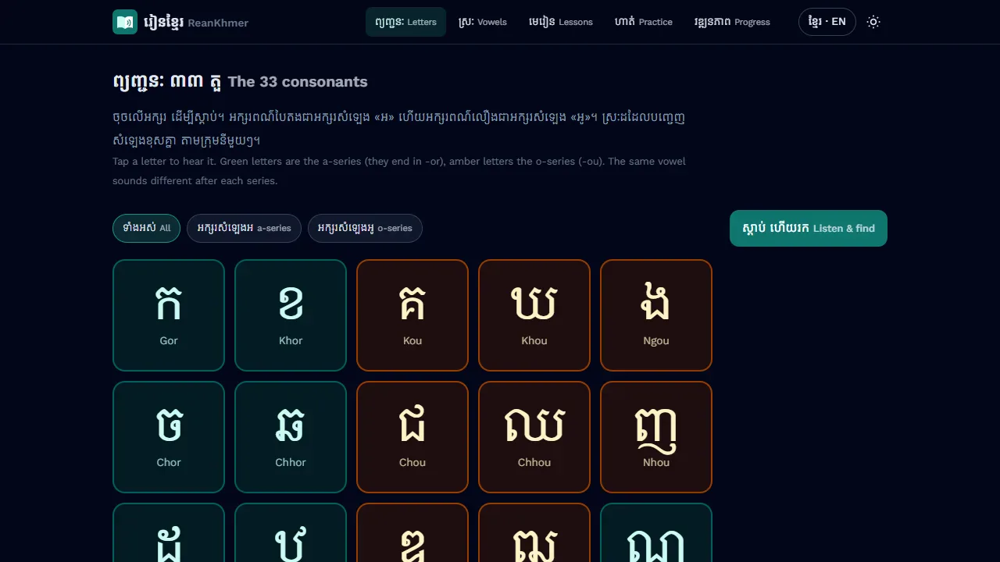

<p align="center">
  
</p>

<h1 align="center">ReanKhmer · រៀនខ្មែរ</h1>

<p align="center">
  <b>Learn to read, hear and speak Khmer: free, in your browser, even offline.</b><br>
  For Khmer families abroad and anyone who wants to learn the language of Cambodia.
</p>

<p align="center">
  <a href="https://rean.seuksa.com"><b>▶ Open ReanKhmer</b></a> ·
  <a href="https://seuksa.com/blog/reankhmer-story/">Read the story</a> ·
  <a href="https://buymeacoffee.com/mtstuffs">Support us</a>
</p>

<p align="center">
  
</p>

## Our story

In **2006**, three students at the Royal University of Phnom Penh built a Khmer learning program for the
RUPP Science Fair. Colleagues at CSC Cambodia lent their studio, and native speakers recorded about
**300 letters, words, stories and dialogues**. It ran on Windows XP, with Flash animations showing how
to write every letter.

Computers changed, Flash disappeared and the source code was lost. But the program itself survived.
Twenty years later, in **2026**, we recovered every lesson, every recording and every writing animation
from it and rebuilt ReanKhmer as a modern web app that works on any phone or computer.

Why? Because many Khmer children growing up abroad can understand their grandparents but can't read
a letter to them. ReanKhmer is our small way to help them, for free.

## What you can learn

<p align="center">
  
</p>

- **Letters**: the 33 consonants in sets of five, as Cambodian children learn them. Tap to hear, then play "Listen & find".
- **Vowels**: every vowel with both of its sounds.
- **Syllables**: put a consonant, a subscript and a vowel together and hear each step.
- **Numbers**: number words, and a reader that says any number aloud in Khmer.
- **Lessons**: 21 lessons with stories, word cards, dialogues and quizzes.
- **Writing**: the original 2006 stroke-by-stroke animations, plus a tracing pad.
- **Typing**: learn the standard Khmer keyboard with an on-screen keyboard and a 2-minute game.
- **Daily review**: a few minutes a day to remember what you learned.

Everything is in Khmer, English or both side by side. It installs like a phone app, keeps your
progress on your own device, and works without internet once downloaded.

## The people behind it

**The ReanKhmer team (2006)**: Sok Pongsametrey, Sok Leaksmy and Ouk Sidavy, who came up with the idea,
built the platform and made the Flash work. ReanKhmer remains the work of all three.
With thanks to our colleagues at **CSC Cambodia** for the studio, the equipment and the recordings.

**Sok Pongsametrey** led the team, wrote all the lesson content, and rebuilt ReanKhmer in 2026.
He has spent nearly 20 years building software in Cambodia and is COO of POSCAR Digital. Alongside work
he writes and builds free tools for Khmer speakers:

- 🌐 [pongsametrey.com](https://www.pongsametrey.com), personal blog
- 💼 [LinkedIn](https://linkedin.com/in/pongsametreysok)
- 💻 [OSIFY](https://osify.com): notes on code and computing since 2008, many in Khmer
- 📚 [Seuksa](https://seuksa.com): education for Khmer society, with the Nitean library of Khmer folktales
- 🐙 [GitHub](https://github.com/metrey)

## Support ReanKhmer

ReanKhmer is free, without ads, and always will be. If it helps your family, a coffee keeps us going:

<a href="https://buymeacoffee.com/mtstuffs"></a>

You can also help by sharing **https://rean.seuksa.com** with a Khmer family you know.

## Built with

[Astro](https://astro.build), [Vue](https://vuejs.org) and [Tailwind CSS](https://tailwindcss.com);
the 2006 Flash animations are played by [Ruffle](https://ruffle.rs). Hosted on GitHub Pages.

| Folder | What |
| --- | --- |
| `app/` | The web app |
| `content/` | All lesson content as plain JSON: letters, vowels, numbers, lessons, dictionary |
| `assets/` | Recordings and pictures |
| `legacy/` | The original 2006 files, kept for reference |

Run it on your computer:

```sh
cd app
npm install
npm run dev
```

The original 2006 program is at [metrey/LearningKhmer](https://github.com/metrey/LearningKhmer) (MIT).
